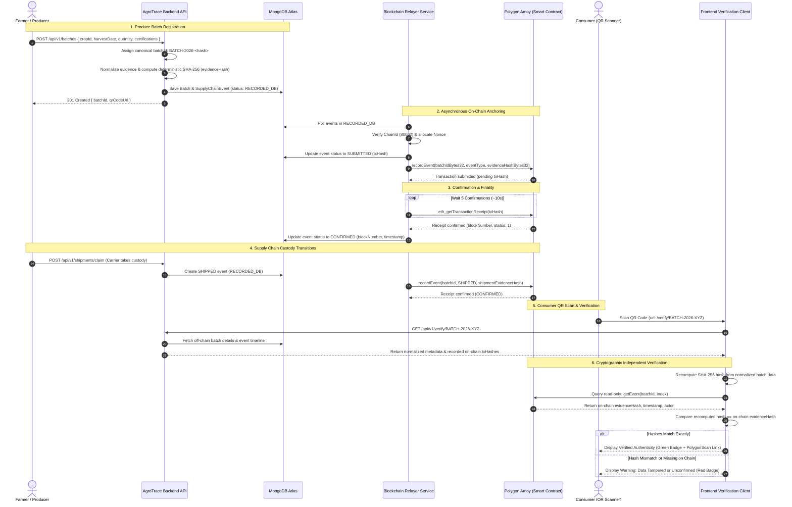
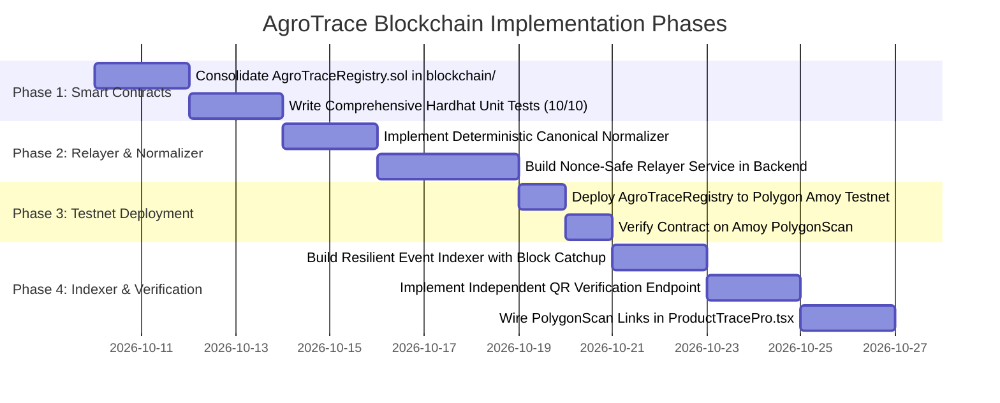

# PROJECT LEAD DIRECTIVE 009 — BLOCKCHAIN ARCHITECTURE AUDIT REPORT

**Project:** AgroTrace  
**Priority:** High — Core Product Feature  
**Date:** October 9, 2026  
**Mode:** Read-Only Inspection & Architecture Planning  
**Repository Working Directory:** `C:\Users\chinn\Desktop\AgroTrace`  
**Host Node Binary:** `C:\Program Files\Adobe\Adobe Creative Cloud Experience\libs\node.exe` (Node v24.13.0)  
**Overall Architecture Recommendation:** **CONSOLIDATE INTO `blockchain/` (POLYGON AMOY TESTNET)**

---

## 1. Repository & Baseline Preservation Evidence

### Current Git Status
- **Current Branch:** `main` (Diverged: 8 commits ahead of origin/main, 1 behind).
- **Current HEAD Commit:** `eea2f35fb2dfe9fd8cf7f0bc1d063b1d267135ce` (`fix(cors-auth): resolve CORS preflight, rate-limiting, and cross-domain authentication`).
- **Working Tree State (`git status --short`):**
  - `D Documentation/atlas-credentials.env` (Staged for deletion from index; preserved on disk; ignored via `.gitignore`).
  - Pre-existing uncommitted modifications preserved: `.env.example`, `.gitignore`, `apps/backend/.env.example`, `apps/backend/README.md`, `apps/backend/package.json`, `apps/backend/src/controllers/auth.controller.ts`, `apps/backend/src/controllers/order.controller.ts`, `apps/backend/src/controllers/shipment.controller.ts`, `apps/backend/src/routes/order.routes.ts`, `apps/backend/src/routes/weather.routes.ts`, `apps/backend/src/server.ts`, `apps/backend/src/services/agmarknet.service.ts`, `apps/web/src/App.tsx`, `apps/web/src/components/WeatherWidget.tsx`, `apps/web/src/pages/Login.tsx`, `apps/web/src/pages/Marketplace.tsx`, `apps/web/src/pages/WeatherIntelligence.tsx`, `package-lock.json`, `package.json`, `packages/prisma/schema.prisma`, `packages/prisma/seed.ts`, `render.yaml`.
  - Untracked files preserved: `apps/backend/reset-passwords.js`, `apps/backend/src/__tests__/`, `apps/backend/src/controllers/payment.controller.ts`, `apps/backend/src/controllers/weather.controller.ts`, `apps/backend/src/routes/payment.routes.ts`, `p0_directive004_verification_report.md`, `p0_directive005_final_review_report.md`, `p0_directive006_refund_readiness_report.md`, `p0_directive007_webhook_recovery_report.md`, `stop.bat`.
- **Backup Verification:**
  - Backup Branch: `backup/head-eea2f35` verified present at `eea2f35fb2dfe9fd8cf7f0bc1d063b1d267135ce`.
  - Patch Archive: Intact in `scratch/` (`directive003_checkpoint.patch`, `directive004_complete.patch`, `directive005_complete.patch`, `directive006_complete.patch`, `atlas-credentials.env.bak`).
- **Safety Execution Policy:**
  - Zero `git reset`, `git clean`, `git checkout`, or history rewriting commands executed.
  - Zero contract deployments, wallet transactions, or blockchain network calls executed.
  - Zero private keys, seed phrases, or sensitive RPC credentials printed or exposed.

---

## 2. Audit of Both Blockchain Implementations

The repository contains two separate, fragmented blockchain directories created at different stages of project development:

1. **`blockchain/`** (`agrotrace-blockchain`): A lean Hardhat project targeting the modern Polygon Amoy testnet.
2. **`services/blockchain/`** (`@agritrace/blockchain`): An older, feature-rich Hardhat TypeScript project targeting the deprecated Polygon Mumbai testnet, containing supply-chain tracking and AI prediction provenance contracts.

### Comprehensive Comparison Table

| Attribute | Implementation 1: `blockchain/` | Implementation 2: `services/blockchain/` |
| :--- | :--- | :--- |
| **Directory Path** | [`blockchain/`](file:///c:/Users/chinn/Desktop/AgroTrace/blockchain) | [`services/blockchain/`](file:///c:/Users/chinn/Desktop/AgroTrace/services/blockchain) |
| **Package Name** | `agrotrace-blockchain` (v1.0.0) | `@agritrace/blockchain` (v1.0.0) |
| **Smart Contracts** | [`Traceability.sol`](file:///c:/Users/chinn/Desktop/AgroTrace/blockchain/contracts/Traceability.sol) (86 lines) | [`SupplyChain.sol`](file:///c:/Users/chinn/Desktop/AgroTrace/services/blockchain/contracts/SupplyChain.sol) (292 lines), [`PredictionProvenance.sol`](file:///c:/Users/chinn/Desktop/AgroTrace/services/blockchain/contracts/PredictionProvenance.sol) (113 lines) |
| **Solidity Version** | `^0.8.24` | `^0.8.20` |
| **Target Networks** | `localhost` (8545), `amoy` (Polygon Amoy Bor RPC) | `hardhat` (31337), `mumbai` (ChainId 80001, **DEPRECATED**) |
| **Network Configuration File** | [`hardhat.config.js`](file:///c:/Users/chinn/Desktop/AgroTrace/blockchain/hardhat.config.js) (CommonJS) | [`hardhat.config.ts`](file:///c:/Users/chinn/Desktop/AgroTrace/services/blockchain/hardhat.config.ts) (TypeScript) |
| **Dependencies & Node Modules** | `node_modules` present; Hardhat 2.19.4, Ethers 6.10.0 installed locally. Compiles cleanly with exit code 0. | **No local `node_modules`**. Running Hardhat fails with `Error HH12: non-local installation`. |
| **Access Control** | Simple custom owner & `authorizedActors` mapping. | OpenZeppelin `AccessControl` (`DEFAULT_ADMIN_ROLE`, `FARMER_ROLE`, `DISTRIBUTOR_ROLE`, `PAUSER_ROLE`, `WRITER_ROLE`). |
| **Contract State & Data Model** | **Hash-Anchoring Model:** Stores only `string batchId`, `string eventType`, and `string metadataHash` (SHA-256). | **Storage-Heavy Model:** Stores raw `string location` and raw `string metadata` (up to 2048 bytes of JSON) directly in Solidity storage! |
| **Real vs. Simulated On-Chain** | Contract code is real. In backend runtime, local mode returns pseudo-random simulated hashes (`crypto.randomBytes(32)`). No contract deployed to Amoy testnet. | Contract code is real. Unit tests run against local Hardhat node in memory. Mumbai deployment is dead. Localhost deployment file contains hardcoded Hardhat account 0. |
| **Deployment Records** | [`contract-address.json`](file:///c:/Users/chinn/Desktop/AgroTrace/blockchain/contract-address.json) (`0x5FbDB...` - Hardhat local default) | [`deployment-info.json`](file:///c:/Users/chinn/Desktop/AgroTrace/services/blockchain/deployment-info.json) (`0x5FbDB...`, `0xe7f17...` - Hardhat local defaults) |
| **Backend Integration** | **Active Primary:** Wired to [`blockchain.service.ts`](file:///c:/Users/chinn/Desktop/AgroTrace/apps/backend/src/services/blockchain.service.ts) and invoked from `supplyChain.controller.ts`, `payment.controller.ts`, `shipment.controller.ts`. | **Partial/Secondary:** `PredictionProvenance.sol` is wired to [`provenance.service.ts`](file:///c:/Users/chinn/Desktop/AgroTrace/apps/backend/src/services/provenance.service.ts) & [`provenanceListener.ts`](file:///c:/Users/chinn/Desktop/AgroTrace/apps/backend/src/services/provenanceListener.ts). `SupplyChain.sol` is **not connected**. |
| **Frontend Integration** | Displays `transactionHash` in [`ProductTracePro.tsx`](file:///c:/Users/chinn/Desktop/AgroTrace/apps/web/src/pages/ProductTracePro.tsx). Explorer link icon is non-clickable. Verification trusts MongoDB boolean flag. | Displays AI Prediction Provenance card in `ProductTracePro.tsx`. |
| **Unit Test Coverage** | **0 tests** (no `test/` directory). | **15 tests** (`SupplyChain.test.ts`: 10 tests, `PredictionProvenance.test.ts`: 5 tests). Cannot run without `npm install`. |
| **Critical Deficiencies** | 1. No on-chain duplicate prevention.<br>2. `metadataHash` stored as `string` instead of `bytes32`.<br>3. Non-deterministic JSON string hashing in service.<br>4. No unit test suite. | 1. **Severe privacy violation:** Stores raw location and up to 2KB metadata directly on public blockchain.<br>2. **Prohibitive gas cost:** Storing 2KB JSON costs >250k gas/event.<br>3. Non-deterministic event hash uses `blockhash(block.number - 1)` and `nonce`.<br>4. Targets shut-down Polygon Mumbai testnet.<br>5. Missing `node_modules`. |
| **Recommendation** | **REUSE & CONSOLIDATE:** Retain as the canonical blockchain directory; modernize the contract and configuration. | **RETIRE `SupplyChain.sol` & Mumbai config; PRESERVE `PredictionProvenance.sol`** for AI provenance. |

---

## 3. Reusable vs. Duplicate or Simulated Components

### Reusable Components
1. **Hash-Anchoring Design Pattern ([`Traceability.sol`](file:///c:/Users/chinn/Desktop/AgroTrace/blockchain/contracts/Traceability.sol)):**
   Storing off-chain evidence hashes rather than raw data on-chain is the correct architecture for privacy, gas economics, and scalability.
2. **Polygon Amoy Configuration ([`blockchain/hardhat.config.js`](file:///c:/Users/chinn/Desktop/AgroTrace/blockchain/hardhat.config.js)):**
   Polygon Amoy (EVM Chain ID `80002`) is Polygon's active Sepolia-anchored testnet. The configuration, RPC endpoint, and deployment tasks in `blockchain/` are directly viable.
3. **OpenZeppelin Role-Based Access Control ([`SupplyChain.sol`](file:///c:/Users/chinn/Desktop/AgroTrace/services/blockchain/contracts/SupplyChain.sol)):**
   The RBAC structure (`DEFAULT_ADMIN_ROLE`, `PAUSER_ROLE`, `FARMER_ROLE`, `DISTRIBUTOR_ROLE`) and `Pausable` / `ReentrancyGuard` from `SupplyChain.sol` are robust and should be incorporated into the canonical contract.
4. **AI Prediction Provenance Subsystem ([`PredictionProvenance.sol`](file:///c:/Users/chinn/Desktop/AgroTrace/services/blockchain/contracts/PredictionProvenance.sol)):**
   The prediction anchoring service ([`provenance.service.ts`](file:///c:/Users/chinn/Desktop/AgroTrace/apps/backend/src/services/provenance.service.ts)) correctly implements canonical key-sorting (`Object.keys(inputSnapshot).sort()`) and `bytes32` hash anchoring. It is viable as an auxiliary provenance module.
5. **QR Code Utility ([`qrService.ts`](file:///c:/Users/chinn/Desktop/AgroTrace/apps/backend/src/services/qrService.ts)):**
   High error correction level (`H`), PNG data URL generation, and route endpoints can be reused immediately.
6. **Timeline Visualization UI ([`ProductTracePro.tsx`](file:///c:/Users/chinn/Desktop/AgroTrace/apps/web/src/pages/ProductTracePro.tsx)):**
   The UI layout, icon badge system, and step timeline provide an excellent user experience, needing only wiring to real on-chain verification links.

### Duplicate Components (To Be Consolidated)
1. **Dual Hardhat Workspaces:** Two competing packages (`blockchain/` vs `services/blockchain/`) with separate `package.json`, compile caches, and deployment records.
2. **Dual Deployment Metadata Files:** `blockchain/contract-address.json` vs `services/blockchain/deployment-info.json`.
3. **Dual Event Type Definitions:**
   - Solidity enum in `SupplyChain.sol` (9 values).
   - String parameters in `Traceability.sol`.
   - Prisma enum `EventType` in `packages/prisma/schema.prisma`.
4. **Competing Frontend Verification Routes:**
   - `/trace/:id` (mapped to `ProductTracePro.tsx`).
   - `/verify/:id` (mapped to `Verify.tsx`).

### Simulated / Placeholder Components (To Be Replaced)
1. **Simulated Hash Fallback in Backend ([`blockchain.service.ts:106, 130`](file:///c:/Users/chinn/Desktop/AgroTrace/apps/backend/src/services/blockchain.service.ts#L106)):**
   ```typescript
   const fakeHash = '0x' + crypto.randomBytes(32).toString('hex');
   return { txHash: fakeHash, metadataHash, simulated: true };
   ```
   When `BLOCKCHAIN_NETWORK` is unset or `local`, the backend fabricates 32-byte hex strings.
2. **MongoDB Placeholder Transaction Hashes ([`payment.controller.ts:225`](file:///c:/Users/chinn/Desktop/AgroTrace/apps/backend/src/controllers/payment.controller.ts#L225), [`shipment.controller.ts:235`](file:///c:/Users/chinn/Desktop/AgroTrace/apps/backend/src/controllers/shipment.controller.ts#L235)):**
   Controllers populate `transactionHash` with `pending-${Date.now()}-${random}` to satisfy the `@unique` constraint in `schema.prisma` before submitting to the blockchain.
3. **Frontend Simulated Blockchain Verification ([`verify.controller.ts:131`](file:///c:/Users/chinn/Desktop/AgroTrace/apps/backend/src/controllers/verify.controller.ts#L131)):**
   The endpoint `/api/v1/verify/:qrCode` reads `evt.verified` directly from MongoDB without validating hashes or issuing any read-only query to the blockchain.
4. **Dummy Explorer Link ([`ProductTracePro.tsx:591`](file:///c:/Users/chinn/Desktop/AgroTrace/apps/web/src/pages/ProductTracePro.tsx#L591)):**
   The UI displays `<ExternalLink className="w-3 h-3 cursor-pointer hover:text-blue-900" />` next to transaction hashes with no `href`, no target URL, and no `onClick` action.

---

## 4. Analysis of Technology Choices & Network Readiness

### Polygon Amoy vs. Polygon Mumbai
- **Polygon Mumbai (Chain ID `80001`):** **Permanently shut down in April 2024** when the Ethereum Goerli testnet was deprecated. All RPC endpoints in `services/blockchain/hardhat.config.ts` (`rpc-mumbai.maticvigil.com`) and `.env.example` fail.
- **Polygon Amoy (Chain ID `80002`):** The active Polygon POS testnet anchored to Ethereum Sepolia. It features:
  - Average block time: ~2.1 seconds.
  - Finality depth: ~5 blocks (~10–12 seconds).
  - Native gas token: Testnet POL / MATIC available via official Polygon faucets.
  - Public RPC: `https://polygon-amoy-bor-rpc.publicnode.com` or `https://rpc-amoy.polygon.technology`.
  - Block Explorer: `https://amoy.polygonscan.com`.
- **Verdict:** Polygon Amoy is **verified suitable and correct**.

### Contract Deployment Status
- Neither `Traceability.sol` nor `SupplyChain.sol` is currently deployed on Polygon Amoy.
- The addresses in `contract-address.json` and `deployment-info.json` (`0x5FbDB2315678afecb367f032d93F642f64180aa3`) are the deterministic deployment address of Hardhat's Account #0 on a fresh local chain (`chainId: 31337`).

### Environment Variable & Configuration Inconsistencies

A critical discrepancy exists between `.env.example`, `render.yaml`, and the backend code:

| Component | Network Flag | RPC URL Key | Contract Key | Private Key |
| :--- | :--- | :--- | :--- | :--- |
| **`.env.example` (Root & Backend)** | *Missing* | `POLYGON_RPC_URL` (pointing to Mumbai) | *Missing* | `CONTRACT_OWNER_PRIVATE_KEY` |
| **`render.yaml`** | `BLOCKCHAIN_NETWORK: amoy` | `RPC_URL` | `TRACEABILITY_CONTRACT_ADDRESS` | `CONTRACT_OWNER_PRIVATE_KEY` |
| **`blockchain/hardhat.config.js`** | N/A | `POLYGON_RPC_URL` | N/A | `CONTRACT_OWNER_PRIVATE_KEY` |
| **`blockchain.service.ts`** | `BLOCKCHAIN_NETWORK` | `RPC_URL` | `TRACEABILITY_CONTRACT_ADDRESS` | `CONTRACT_OWNER_PRIVATE_KEY` |

**Deficiency:** In `.env.example`, the RPC URL is named `POLYGON_RPC_URL`, but [`blockchain.service.ts:63`](file:///c:/Users/chinn/Desktop/AgroTrace/apps/backend/src/services/blockchain.service.ts#L63) reads `process.env.RPC_URL`. If configured using `.env.example`, the backend silently crashes or fails to initialize in Amoy mode.

---

## 5. End-to-End Batch Traceability Sequence

The canonical traceability workflow guarantees complete data integrity from farmer harvest to consumer scan while preserving farmer privacy and preventing duplicate blockchain submissions.



### Detailed Stage Breakdown

1. **Batch Registration:**
   - Farmer enters produce data.
   - Backend assigns a stable, collision-free batch ID: `BATCH-<cropId>-<timestampHex>`.
2. **Deterministic Evidence Normalization:**
   - Raw payload is stripped of non-verifiable internal identifiers.
   - Keys are sorted lexicographically; floating point values are formatted to fixed precision; timestamps are formatted as ISO 8601 UTC.
   - 32-byte cryptographic hash is generated: `evidenceHash = sha256(canonicalPayload)`.
3. **Relayer Submission:**
   - Relayer fetches unanchored events, checks wallet balance, queries the current network nonce, and submits the transaction with EIP-1559 gas parameters.
   - Transaction status transitions: `RECORDED_DB` $\to$ `SUBMITTED`.
4. **On-Chain Confirmation:**
   - Relayer monitors receipts. Once the transaction achieves 5 confirmations on Polygon Amoy, the status transitions to `CONFIRMED`.
   - If the transaction reverts, it transitions to `FAILED` with error diagnostics.
5. **Supply Chain Custody Events:**
   - Subsequent actors (distributor, carrier, retailer) log events (`HARVESTED`, `PACKAGED`, `SHIPPED`, `RECEIVED`, `QUALITY_CHECK`).
   - Each event contains its own cryptographic commitment anchored to the same `batchId`.
6. **Consumer QR Code Verification:**
   - QR code encodes: `https://agrotrace.app/verify/<batchId>`.
   - Consumer client queries public JSON-RPC directly to retrieve the on-chain hash and confirms it matches the backend metadata.

---

## 6. Contract Design & Data-Storage Boundaries

### Off-Chain vs. On-Chain Data Separation

To ensure GDPR/privacy compliance, prevent data leaks, and minimize Polygon gas costs, the data boundary must be strictly enforced:

| Data Element | Storage Location | Rationale & Protection |
| :--- | :--- | :--- |
| **Farmer Name & Phone** | **OFF-CHAIN (MongoDB)** | Personal Identifiable Information (PII); legally prohibited from immutable ledgers. |
| **Exact Farm GPS Coordinates** | **OFF-CHAIN (MongoDB)** | Privacy and security of agricultural land. |
| **Commercial Price & Margins** | **OFF-CHAIN (MongoDB)** | Trade secret and commercial confidentiality. |
| **Detailed Quality & Lab PDFs** | **OFF-CHAIN (MongoDB / S3)** | High storage footprint; stored off-chain, referenced by SHA-256 hash. |
| **Batch Identifier (`batchId`)** | **BOTH (`bytes32` on-chain)** | Public lookup key linking physical produce to ledger. |
| **Event Type Enum (`uint8`)** | **BOTH (`uint8` on-chain)** | Minimal classification (0=PLANTED ... 8=SOLD). Cost: 1 byte. |
| **Evidence Hash (`evidenceHash`)** | **ON-CHAIN (`bytes32`)** | Immutable cryptographic commitment. Cost: 32 bytes. |
| **Block Timestamp & Block Number** | **ON-CHAIN (EVM native)** | Tamper-proof proof of existence generated by consensus. |
| **Relayer Address (`msg.sender`)** | **ON-CHAIN (`address`)** | Proof of authorization. Cost: 20 bytes. |

### Gas Economics: Raw Metadata vs. Cryptographic Commitment

- **Implementation 2 (`SupplyChain.sol`):** Stores 2,048 bytes of string metadata in contract storage:
  - Base SSTORE cost: $\approx 20,000 \text{ gas per 32 bytes}$.
  - Storing 2,048 bytes: $64 \times 20,000 = \mathbf{1,280,000 \text{ gas}}$!
  - Under typical network conditions, this costs 0.05–0.15 MATIC per event and frequently hits transaction gas limits.
- **Proposed Canonical Contract (`AgroTraceRegistry.sol`):** Stores only `bytes32 batchId`, `uint8 eventType`, and `bytes32 evidenceHash`:
  - Exactly two 32-byte storage slots per event: $\approx \mathbf{45,000 \text{ to } 65,000 \text{ gas}}$.
  - **Gas savings: >95% reduction** per supply chain event.

### Proposed Canonical Smart Contract (`AgroTraceRegistry.sol`)

The consolidated smart contract combines the lean hash-storage model of `Traceability.sol` with the mature access control, pausable guards, and pagination of `SupplyChain.sol`:

```solidity
// SPDX-License-Identifier: MIT
pragma solidity ^0.8.24;

import "@openzeppelin/contracts/access/AccessControl.sol";
import "@openzeppelin/contracts/utils/Pausable.sol";
import "@openzeppelin/contracts/utils/ReentrancyGuard.sol";

/**
 * @title AgroTraceRegistry
 * @dev Gas-optimized, privacy-preserving agricultural batch traceability registry.
 */
contract AgroTraceRegistry is AccessControl, Pausable, ReentrancyGuard {
    
    bytes32 public constant RELAYER_ROLE = keccak256("RELAYER_ROLE");
    bytes32 public constant PAUSER_ROLE = keccak256("PAUSER_ROLE");

    enum EventType {
        PLANTED,
        HARVESTED,
        PROCESSED,
        PACKAGED,
        SHIPPED,
        RECEIVED,
        QUALITY_CHECK,
        RETAIL,
        SOLD
    }

    struct TraceEvent {
        EventType eventType;
        bytes32 evidenceHash;
        uint64 timestamp;
        address recordedBy;
    }

    struct BatchRecord {
        bytes32 batchId;
        bytes32 initialEvidenceHash;
        uint64 registeredAt;
        bool exists;
    }

    // Mapping from batchId => BatchRecord
    mapping(bytes32 => BatchRecord) public batches;

    // Mapping from batchId => array of TraceEvent
    mapping(bytes32 => TraceEvent[]) private batchEvents;

    // Mapping to prevent duplicate event hash replay: keccak256(batchId, eventType, evidenceHash) => bool
    mapping(bytes32 => bool) public recordedCommitments;

    // Events for off-chain indexing
    event BatchRegistered(bytes32 indexed batchId, bytes32 indexed evidenceHash, uint64 timestamp, address indexed relayer);
    event EventRecorded(bytes32 indexed batchId, EventType indexed eventType, bytes32 indexed evidenceHash, uint64 timestamp, address relayer);

    constructor(address admin, address relayer) {
        _grantRole(DEFAULT_ADMIN_ROLE, admin);
        _grantRole(PAUSER_ROLE, admin);
        _grantRole(RELAYER_ROLE, relayer);
    }

    function pause() external onlyRole(PAUSER_ROLE) { _pause(); }
    function unpause() external onlyRole(PAUSER_ROLE) { _unpause(); }

    /**
     * @dev Register a new batch with initial produce evidence.
     */
    function registerBatch(bytes32 batchId, bytes32 evidenceHash) external whenNotPaused onlyRole(RELAYER_ROLE) nonReentrant {
        require(batchId != bytes32(0), "Invalid batchId");
        require(evidenceHash != bytes32(0), "Invalid evidenceHash");
        require(!batches[batchId].exists, "Batch already registered");

        batches[batchId] = BatchRecord({
            batchId: batchId,
            initialEvidenceHash: evidenceHash,
            registeredAt: uint64(block.timestamp),
            exists: true
        });

        emit BatchRegistered(batchId, evidenceHash, uint64(block.timestamp), msg.sender);
    }

    /**
     * @dev Record a custody or processing event for an existing batch.
     */
    function recordEvent(bytes32 batchId, EventType eventType, bytes32 evidenceHash) external whenNotPaused onlyRole(RELAYER_ROLE) nonReentrant {
        require(batches[batchId].exists, "Batch does not exist");
        require(evidenceHash != bytes32(0), "Invalid evidenceHash");

        bytes32 commitmentKey = keccak256(abi.encodePacked(batchId, eventType, evidenceHash));
        require(!recordedCommitments[commitmentKey], "Duplicate event commitment");
        recordedCommitments[commitmentKey] = true;

        batchEvents[batchId].push(TraceEvent({
            eventType: eventType,
            evidenceHash: evidenceHash,
            timestamp: uint64(block.timestamp),
            recordedBy: msg.sender
        }));

        emit EventRecorded(batchId, eventType, evidenceHash, uint64(block.timestamp), msg.sender);
    }

    /**
     * @dev Get total events for a batch.
     */
    function getEventCount(bytes32 batchId) external view returns (uint256) {
        return batchEvents[batchId].length;
    }

    /**
     * @dev Get a specific event by index (pagination support).
     */
    function getEvent(bytes32 batchId, uint256 index) external view returns (EventType eventType, bytes32 evidenceHash, uint64 timestamp, address recordedBy) {
        require(index < batchEvents[batchId].length, "Index out of bounds");
        TraceEvent memory evt = batchEvents[batchId][index];
        return (evt.eventType, evt.evidenceHash, evt.timestamp, evt.recordedBy);
    }

    /**
     * @dev Independent verification check.
     */
    function verifyCommitment(bytes32 batchId, EventType eventType, bytes32 evidenceHash) external view returns (bool) {
        bytes32 commitmentKey = keccak256(abi.encodePacked(batchId, eventType, evidenceHash));
        return recordedCommitments[commitmentKey];
    }
}
```

---

## 7. Security, Transaction & Recovery Considerations

### 1. Private Key & Relayer Management
- **Never store private keys in source code or Git history.**
- Use a dedicated **EVM Relayer Wallet** funded only with minimal testnet POL (e.g. 2–5 POL).
- In production, utilize AWS Secrets Manager or Google Cloud Secret Manager to provide `RELAYER_PRIVATE_KEY` to the background relayer worker.

### 2. Transaction Lifecycle & State Transitions
The system must distinguish five discrete transaction states in the database:

```
[RECORDED_DB] ──► [SUBMITTED] ──► [IN_BLOCK] ──► [CONFIRMED]
      │                 │               │
      └─────────────────┴───────────────┴────────► [FAILED / REVERTED]
```

- **`RECORDED_DB`:** The business event is committed to MongoDB. No blockchain transaction has been sent yet.
- **`SUBMITTED`:** The relayer has broadcast the transaction to the Polygon RPC with a specific nonce and `txHash`.
- **`IN_BLOCK`:** The transaction is included in block `N` (1 confirmation).
- **`CONFIRMED`:** The transaction has reached finality depth (block `N + 5`). Only now does the frontend display the green "Blockchain Verified" badge.
- **`FAILED` / `REVERTED`:** Transaction dropped, timed out, or reverted by EVM rules.

### 3. Nonce Management & Concurrency
- Polygon nodes reject transactions submitted with out-of-order or duplicate nonces (`NONCE_EXPIRED` or `REPLACEMENT_UNDERPRICED`).
- **Solution:** Implement a **Nonce Queue** in the backend relayer. The relayer manages a local persistent counter synchronized with `eth_getTransactionCount(address, 'pending')`, serializing transaction broadcasts to prevent nonce collisions under concurrent orders.

### 4. Gas Estimation & Transaction Replacement (Bumping)
- During network congestion on Polygon Amoy, base fees fluctuate rapidly.
- If a transaction remains in `SUBMITTED` for >60 seconds without being mined:
  - The relayer sends a replacement transaction using the **same nonce** with a 20% higher `maxPriorityFeePerGas` and `maxFeePerGas` (EIP-1559 speedup).

### 5. Deterministic Normalization Algorithm
To ensure off-chain evidence hashes can be deterministically reproduced across different platforms, languages, and browsers:
```typescript
export function canonicalizeAndHash(evidence: Record<string, any>): string {
  // 1. Recursive key sorting
  const sortKeys = (obj: any): any => {
    if (obj === null || typeof obj !== 'object') return obj;
    if (Array.isArray(obj)) return obj.map(sortKeys);
    return Object.keys(obj)
      .sort()
      .reduce((acc: any, key: string) => {
        acc[key] = sortKeys(obj[key]);
        return acc;
      }, {});
  };

  const canonicalJson = JSON.stringify(sortKeys(evidence));
  return '0x' + crypto.createHash('sha256').update(canonicalJson).digest('hex');
}
```

### 6. Event Indexer Downtime Recovery
- Event listeners using `contract.on(...)` fail silently if the WebSocket drops or the server restarts.
- **Solution:** A reconciliation worker tracks `lastIndexedBlock` in MongoDB (`BlockchainSyncState`).
- On startup and every 5 minutes:
  - Queries `contract.queryFilter(eventFilter, lastIndexedBlock + 1, currentBlock)`.
  - Reconciles any events missed during downtime.
  - Updates `lastIndexedBlock = currentBlock`.

---

## 8. Phased Implementation Plan



### Phase 1: Smart Contract Consolidation & Testing (Days 1–4)
- **Dependencies:** Hardhat 2.19.4 in `blockchain/`.
- **Actions:**
  - Create `blockchain/contracts/AgroTraceRegistry.sol` incorporating OpenZeppelin 5.0.
  - Add comprehensive unit test suite in `blockchain/test/AgroTraceRegistry.test.ts` (access control, batch registration, duplicate rejection, pagination, pausable behavior).
  - Retire `services/blockchain/contracts/SupplyChain.sol`.

### Phase 2: Backend Relayer & Deterministic Hashing (Days 5–9)
- **Dependencies:** `ethers@^6.17.0` in `apps/backend`.
- **Actions:**
  - Implement `apps/backend/src/services/evidenceHasher.ts` with strict JSON key sorting and SHA-256 hash formatting.
  - Upgrade `apps/backend/src/services/blockchain.service.ts` to manage nonces, calculate EIP-1559 gas fees, and enforce the 5-state lifecycle (`RECORDED_DB` $\to$ `CONFIRMED`).
  - Eliminate all random fake hash generation (`crypto.randomBytes(32)`).

### Phase 3: Polygon Amoy Testnet Deployment (Days 10–11)
- **Dependencies:** Testnet POL funded in relayer wallet.
- **Actions:**
  - Execute deployment via `blockchain/scripts/deploy.js --network amoy`.
  - Record contract address in `blockchain/contract-address.json` and backend `.env`.
  - Verify contract source code on Amoy PolygonScan using `@nomicfoundation/hardhat-verify`.

### Phase 4: Indexer & Frontend Verification (Days 12–17)
- **Dependencies:** Polygon Amoy RPC.
- **Actions:**
  - Create `apps/backend/src/workers/blockchainIndexer.worker.ts` with block checkpointing.
  - Create public independent verification endpoint `/api/v1/verify/on-chain/:batchId`.
  - Update `apps/web/src/pages/ProductTracePro.tsx`:
    - Add clickable link to `https://amoy.polygonscan.com/tx/${event.transactionHash}`.
    - Add client-side hash recomputation check comparing on-chain hash vs metadata hash.

---

## 9. Concrete Acceptance Criteria for First Testnet Demonstration

| # | Acceptance Criterion | Verification Command / Procedure | Expected Pass Result |
| :---: | :--- | :--- | :--- |
| **AC-1** | **Deterministic Evidence Hashing** | Unit test hashing identical object with randomized key orders: `{ z: 1, a: 2 }` vs `{ a: 2, z: 1 }`. | Outputs identical 32-byte hash (`0x...`). Single-byte change produces completely different hash. |
| **AC-2** | **Contract Access Control** | Call `registerBatch` from non-relayer address in Hardhat test. | Reverts with custom error `AccessControlUnauthorizedAccount`. |
| **AC-3** | **Duplicate Batch Rejection** | Call `registerBatch` twice with the same `batchId`. | Second call reverts with message `"Batch already registered"`. |
| **AC-4** | **Real Amoy Testnet Deployment** | Inspect Amoy PolygonScan at deployed contract address. | Contract exists, shows verified bytecode, and displays `RELAYER_ROLE` assigned to relayer address. |
| **AC-5** | **Genuine Transaction Confirmation** | Register produce batch via `/api/v1/products/create` in Amoy mode. | MongoDB record contains a 66-character transaction hash (`0x...64hex`). Status transitions `SUBMITTED` $\to$ `CONFIRMED` after 5 blocks. |
| **AC-6** | **Amoy PolygonScan Verifiability** | Open `https://amoy.polygonscan.com/tx/<txHash>`. | Transaction is marked **Success**, calls `recordEvent`, and emits `EventRecorded` event with matching `batchId` and `evidenceHash`. |
| **AC-7** | **Zero Plaintext PII On-Chain** | Inspect transaction input data on PolygonScan. | Input data contains only `bytes32` arguments and `uint8` enum. Zero farmer names, phone numbers, or JSON strings appear in input calldata. |
| **AC-8** | **Independent Verification Check** | Issue GET request to `/api/v1/verify/on-chain/<batchId>`. | Endpoint fetches on-chain hash directly via RPC and returns `{ verified: true, onChainHash: "...", computedHash: "...", match: true }`. |
| **AC-9** | **Tamper Detection Demonstration** | Manually alter 1 character of product description in MongoDB; query verification endpoint. | Endpoint returns `{ verified: false, match: false, error: "Evidence hash mismatch" }`. Frontend displays red alert banner. |
| **AC-10** | **Indexer Downtime Recovery** | Stop backend server; record on-chain event directly via script; restart backend. | Indexer worker detects missed blocks, pulls event from logs, and populates MongoDB record with `CONFIRMED` status. |

---

## 10. Final Architecture Recommendation

### Decision: **CONSOLIDATE INTO `blockchain/`**

1. **Primary Workspace:** Make **[`blockchain/`](file:///c:/Users/chinn/Desktop/AgroTrace/blockchain)** the single, canonical smart contract directory in the repository.
   - It already has local `node_modules` installed.
   - It targets the active **Polygon Amoy** testnet (`hardhat.config.js`).
   - It is already imported by the backend build scripts.
2. **Contract Action:**
   - Replace `Traceability.sol` with the gas-optimized, access-controlled **`AgroTraceRegistry.sol`** design specified in Section 6.
   - Add a robust Hardhat test suite in `blockchain/test/`.
3. **Retire `services/blockchain/SupplyChain.sol`:**
   - Mark `services/blockchain/contracts/SupplyChain.sol` as deprecated. Its storage of 2KB raw JSON directly on-chain violates privacy guidelines and incurs prohibitive gas costs.
   - Deprecate its Mumbai configuration (`services/blockchain/hardhat.config.ts`).
4. **Preserve `PredictionProvenance.sol`:**
   - Retain `PredictionProvenance.sol` in `services/blockchain/contracts/` specifically for AI model inference provenance anchoring, where it is already integrated with `provenance.service.ts`.
5. **Next Steps:**
   - Stop and await Project Lead review of this architecture audit report.
   - Do not deploy contracts or modify application schemas until separate implementation authorization is granted.

---
*Report complete. Ready for Project Lead review.*
