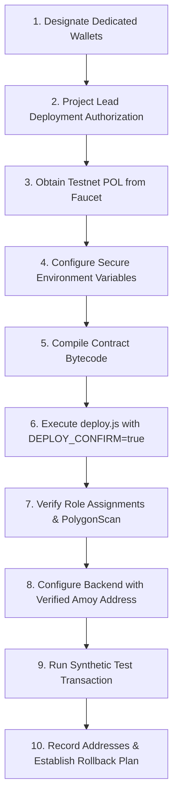

# AgroTrace — Project Lead Directive 014: Polygon Amoy Testnet Preparation Report

**Document ID:** `blockchain_directive014_testnet_preparation_report.md`  
**Date:** October 10, 2026  
**Auditor/Implementer:** Antigravity AI Pair Programmer  
**Directive Priority:** Safe First Public Testnet Preparation  
**Mode:** Read-only audit, local tooling improvements & deployment-readiness checks  
**Deployment Authorization Status:** **NOT GRANTED — ZERO TRANSACTIONS BROADCAST**  

---

## Executive Summary

Under **Project Lead Directive 014**, a comprehensive deployment-readiness assessment and tooling audit was conducted for deploying [`AgroTraceRegistry.sol`](file:///c:/Users/chinn/Desktop/AgroTrace/blockchain/contracts/AgroTraceRegistry.sol) to the Polygon Amoy testnet (`chainId 80002`).

In accordance with strict directive constraints:
1. **Zero Public Interactions:** No transactions were broadcast, no testnet POL was requested, no faucet APIs were accessed, no live wallets were generated, and no public RPC endpoints were contacted.
2. **Zero Hardhat Development Key Leakage:** Strong guards were implemented in both [`deploy.js`](file:///c:/Users/chinn/Desktop/AgroTrace/blockchain/scripts/deploy.js) and [`blockchain.service.ts`](file:///c:/Users/chinn/Desktop/AgroTrace/apps/backend/src/services/blockchain.service.ts) preventing any Hardhat local development keys (`0xac09...ff80`) or local addresses (`0x5FbD...0aa3`) from operating on Polygon Amoy.
3. **Fail-Safe Authorization Gate:** [`deploy.js`](file:///c:/Users/chinn/Desktop/AgroTrace/blockchain/scripts/deploy.js) halts on non-local networks in dry-run mode unless the explicit environment flag `DEPLOY_CONFIRM=true` is supplied, preventing accidental broadcast during compilation, test, or CI execution.
4. **Network & Address Isolation:** Local development (`chainId 31337`) and Polygon Amoy (`chainId 80002`) configurations are strictly partitioned in [`contract-address.json`](file:///c:/Users/chinn/Desktop/AgroTrace/blockchain/contract-address.json), failing closed if Amoy configuration is absent or inconsistent.
5. **Full Toolchain & Regression Verification:** Compiled [`AgroTraceRegistry.sol`](file:///c:/Users/chinn/Desktop/AgroTrace/blockchain/contracts/AgroTraceRegistry.sol) with Solidity `0.8.24`; verified constructor parameter encoding; passed all 23 Hardhat smart contract tests and 79 backend Jest tests (including 8 new dedicated Amoy network isolation tests); and confirmed TypeScript (`tsc --noEmit`) and web production build (`vite build`) with zero errors.

**Final Recommendation:** **`READY FOR SEPARATE DEPLOYMENT AUTHORIZATION`**

---

## 1. Repository Baseline & Preservation Checks

The repository baseline was recorded prior to inspection and preserved in its entirety throughout the preparation:

- **Git Branch:** `main` (tracking `origin/main: ahead 8, behind 1`)
- **HEAD Commit:** `eea2f35fb2dfe9fd8cf7f0bc1d063b1d267135ce`
- **Backup Branches Available:** `backup/head-eea2f35`, `codex-hosting-attempt`, `restore-good-version`
- **Patch Archives Preserved:**
  - `scratch/directive011_baseline.patch` & `scratch/directive011_staged.patch`
  - `scratch/directive012_baseline.patch` & `scratch/directive012_staged.patch`
  - `scratch/directive013_baseline.patch` & `scratch/directive013_staged.patch`
  - `scratch/directive014_state.patch` (captured at the conclusion of D014)
- **Database Boundary:** MongoDB Atlas credentials remained strictly untouched; no connection was established to remote databases.
- **Git Invariant:** Zero destructive Git commands (`reset`, `clean`, `rebase`) were executed; no commits were created or pushed.

---

## 2. Files Inspected and Modified

| File Path | Nature of Inspection / Change | Key Findings / Modifications |
| :--- | :--- | :--- |
| [`blockchain/contracts/AgroTraceRegistry.sol`](file:///c:/Users/chinn/Desktop/AgroTrace/blockchain/contracts/AgroTraceRegistry.sol) | Inspected | Constructor takes `(address admin, address relayer)`. Grants `DEFAULT_ADMIN_ROLE` + `PAUSER_ROLE` to admin, and `RELAYER_ROLE` to relayer. Verified matches ABI and deployment scripts. |
| [`blockchain/hardhat.config.js`](file:///c:/Users/chinn/Desktop/AgroTrace/blockchain/hardhat.config.js) | Modified | Explicitly isolated `localhost` (`chainId 31337`) and `amoy` (`chainId 80002`). Configured Etherscan verification URL for `polygonAmoy` (`https://amoy.polygonscan.com`). |
| [`blockchain/scripts/deploy.js`](file:///c:/Users/chinn/Desktop/AgroTrace/blockchain/scripts/deploy.js) | Modified | Enforced role address validation (`adminAddress`, `relayerAddress`), dry-run pre-flight bytecode check, Hardhat dev account protection, fail-safe `DEPLOY_CONFIRM=true` guard, and network-scoped persistence into `contract-address.json`. |
| [`blockchain/contract-address.json`](file:///c:/Users/chinn/Desktop/AgroTrace/blockchain/contract-address.json) | Modified | Re-architected schema to support chainId-scoped dictionary (`"31337"` and future `"80002"`), while maintaining backward-compatibility for local tests. |
| [`apps/backend/src/services/blockchain.service.ts`](file:///c:/Users/chinn/Desktop/AgroTrace/apps/backend/src/services/blockchain.service.ts) | Modified | Hardened `getConfig()` and `getSignerContract()` to reject local addresses/keys on Amoy, reject localhost RPC on Amoy, fail closed on unconfigured Amoy addresses, and prevent cross-network pollution. |
| [`apps/backend/src/services/eventLifecycle.service.ts`](file:///c:/Users/chinn/Desktop/AgroTrace/apps/backend/src/services/eventLifecycle.service.ts) | Inspected | Verified 5-state lifecycle (`RECORDED_DB`, `SUBMITTED`, `IN_BLOCK`, `CONFIRMED`, `FAILED`). Functions agnostically across local Hardhat and Amoy networks. |
| [`.env.example`](file:///c:/Users/chinn/Desktop/AgroTrace/.env.example) | Modified | Added explicit documentation for `AMOY_DEPLOYER_PRIVATE_KEY`, `AMOY_ADMIN_ADDRESS`, `AMOY_RELAYER_ADDRESS`, `POLYGONSCAN_API_KEY`, and `DEPLOY_CONFIRM="false"`. |
| [`apps/backend/.env.example`](file:///c:/Users/chinn/Desktop/AgroTrace/apps/backend/.env.example) | Modified | Mirrored blockchain and testnet tooling variables with full configuration comments. |
| [`apps/backend/src/__tests__/blockchain_directive014_amoy_isolation.test.ts`](file:///c:/Users/chinn/Desktop/AgroTrace/apps/backend/src/__tests__/blockchain_directive014_amoy_isolation.test.ts) | Created | Added 8 comprehensive unit tests asserting network isolation, security violation enforcement, and configuration invariants. |

---

## 3. Network and Address Isolation Findings

### Invariant 1: Local vs. Polygon Amoy Chain IDs
- **Local Hardhat:** Strictly bound to chain ID `31337` (or fallback testnet `1337`).
- **Polygon Amoy:** Strictly bound to chain ID `80002`.
- **Enforcement:** If `BLOCKCHAIN_NETWORK="amoy"` is configured with any chain ID other than `80002`, `BlockchainService.getConfig()` immediately throws:
  ```text
  [BlockchainService] Inconsistent configuration: Polygon Amoy network requires chain ID 80002, but resolved <id>.
  ```
  Similarly, if `BLOCKCHAIN_NETWORK="local"` is paired with chain ID `80002`, an explicit inconsistency error is thrown.

### Invariant 2: Anti-Leakage of Local Addresses
- In previous revisions, `contract-address.json` stored an unkeyed address (`0x5FbDB2315678afecb367f032d93F642f64180aa3`). If Amoy was selected in `.env`, the service could inadvertently fall back to that address.
- **Remediation:**
  1. `contract-address.json` now keys addresses by chain ID (`"31337"` vs `"80002"`).
  2. In `amoy` mode, `BlockchainService.getConfig()` **only** consults `data['80002']`. If missing, `contractAddress` evaluates to empty string, failing closed.
  3. If a local Hardhat default contract address (`0x5FbDB2315678afecb367f032d93F642f64180aa3`, `0x46b142DD1E924FAb83eCc3c08e4D46E82f005e0E`, or `0xe7f1725E7734CE288F8367e1Bb143E90bb3F0512`) is supplied to Amoy mode via environment variable, `getConfig()` throws:
     ```text
     [BlockchainService] Inconsistent configuration: Local Hardhat contract address (<address>) cannot be used on Polygon Amoy (chainId 80002).
     ```

### Invariant 3: Anti-Leakage of Local Private Keys
- If `BLOCKCHAIN_NETWORK="amoy"` or `expectedChainId === 80002`, any attempt to sign transactions using the default Hardhat Account #0 key (`0xac0974bec39a17e36ba4a6b4d238ff944bacb478cbed5efcae784d7bf4f2ff80`) throws a high-severity security error:
  ```text
  [BlockchainService] Security violation: Hardhat development private key is strictly prohibited on Polygon Amoy.
  ```
- In `deploy.js`, attempting to deploy to Amoy using Account #0 address `0xf39Fd6e51aad88F6F4ce6aB8827279cffFb92266` throws:
  ```text
  [Deploy Error] Security violation: Hardhat default development account (0xf39Fd6e51aad88F6F4ce6aB8827279cffFb92266) is strictly prohibited on public networks.
  ```

### Invariant 4: RPC URL Isolation
- If `BLOCKCHAIN_NETWORK="amoy"` is configured with an RPC URL containing `127.0.0.1` or `localhost`, `getConfig()` throws:
  ```text
  [BlockchainService] Inconsistent configuration: Localhost RPC URL (<url>) cannot be used with Polygon Amoy.
  ```

---

## 4. Deployment-Script & Role-Assignment Review

### Role Structure in `AgroTraceRegistry.sol`
```solidity
constructor(address admin, address relayer) {
    require(admin != address(0), "Admin cannot be zero address");
    require(relayer != address(0), "Relayer cannot be zero address");

    _grantRole(DEFAULT_ADMIN_ROLE, admin);
    _grantRole(PAUSER_ROLE, admin);
    _grantRole(RELAYER_ROLE, relayer);
}
```

### Role Implications: Single Account vs. Separate Accounts
1. **Administrative Rights (`DEFAULT_ADMIN_ROLE`, `PAUSER_ROLE`):**
   - Held by the contract owner / governance wallet.
   - Authorizes role granting/revoking, contract pausing in emergencies, and potential upgrades.
   - Infrequent interaction; should ideally be a cold wallet, multisig (e.g. Safe), or hardware-secured key.
2. **Operational Relayer Rights (`RELAYER_ROLE`):**
   - Authorizes calling `registerBatch(...)` and `recordEvent(...)`.
   - Frequent automated interaction by backend service daemons.
   - Holds hot POL funds for gas fees.
3. **Risk Analysis of a Shared Single Account:**
   - If the backend hot wallet relayer key is compromised, an attacker gaining relayer rights would also gain full administrative ownership, allowing them to freeze or reconfigure roles.
   - **Directive Recommendation for Amoy:** Require **separate addresses** for `AMOY_ADMIN_ADDRESS` and `AMOY_RELAYER_ADDRESS`. The deployment script now explicitly requires `AMOY_RELAYER_ADDRESS` in non-local environments and prohibits silently defaulting the relayer to the deployer address.

### Fail-Safe Deployment Guard in `deploy.js`
When executed against any non-local network (including Amoy), `deploy.js`:
1. Validates the deployer signer.
2. Confirms the connected chain ID matches the network target.
3. Validates the formats of `adminAddress` and `relayerAddress`.
4. Compiles and encodes the deployment transaction bytecode locally.
5. Inspects `process.env.DEPLOY_CONFIRM`. If not `"true"`, it logs the pre-flight summary and **halts with zero transactions broadcast**:
   ```text
   ------------------------------------------------------------------
   DRY-RUN READINESS CHECK COMPLETED SUCCESSFULLY.
   Contract bytecode, compiler configuration, and role targets verified.
   DEPLOYMENT HALTED: Testnet transaction broadcasting is NOT authorized.
   To execute live deployment in a separately authorized milestone, set DEPLOY_CONFIRM=true.
   ==================================================================
   ```

---

## 5. Toolchain Validation & Exact Test Results

All tests were executed locally without external network calls.

### 1. Smart Contract Compilation & Bytecode Inspection
- **Compiler:** Hardhat v2.19.4 / Solc `0.8.24`
- **Output:** Clean compilation; ABI and artifact generated at `blockchain/artifacts/contracts/AgroTraceRegistry.sol/AgroTraceRegistry.json`.
- **Bytecode Size:** 7,370 bytes (well within the Spurious Dragon 24,576-byte EVM limit).

### 2. Hardhat Contract Unit Tests
Command: `node node_modules/hardhat/internal/cli/bootstrap.js test test/AgroTraceRegistry.test.ts`
```text
  AgroTraceRegistry
    1. Deployment & Role Setup
      √ Should correctly initialize DEFAULT_ADMIN_ROLE and PAUSER_ROLE to admin
      √ Should correctly initialize RELAYER_ROLE to relayer
      √ Should revert if admin or relayer is zero address
    2. Batch Registration (Requirement 1, 2, 4, 15)
      √ Authorized batch registration succeeds with atomic initial event
      √ Rejects zero batchId or zero evidenceHash
      √ Duplicate batch registration reverts
      √ Unauthorized registration is rejected
    3. Supply Chain Event Recording (Requirement 6, 7, 8, 9, 10)
      √ Valid events can be appended to an existing batch
      √ Unauthorized event recording is rejected
      √ Events cannot be appended to nonexistent batches
      √ Zero evidence hash is rejected in recordEvent
      √ Duplicate logical event commitments are rejected
      √ Distinct legitimate events of the same eventType are accepted
      √ Full supply-chain progression succeeds across all stages
    4. Emergency Pause & Controlled Unpause (Requirement 11, 12, 13)
      √ Only authorized pauser can pause and unpause
      √ Pause blocks state-changing operations
      √ Unpause restores normal operations
    5. Query Interface, Pagination & Read Idempotency (Requirement 14, 16)
      √ Event counts and indexed queries are correct
      √ getBatchEvents returns complete event array
      √ verifyCommitment returns false for unrecorded commitments
      √ Repeated reads do not change state
    6. State Rollback & Atomicity on Failure (Requirement 17)
      √ Failed registration leaves no partial batch or event state
      √ Failed event recording leaves existing batch state untouched

  23 passing (1s)
```

### 3. Dedicated Directive 014 Amoy Network Isolation Tests
Command: `node node_modules/jest/bin/jest.js src/__tests__/blockchain_directive014_amoy_isolation.test.ts --preset ts-jest`
```text
PASS src/__tests__/blockchain_directive014_amoy_isolation.test.ts
  Directive 014: Polygon Amoy Network & Address Isolation Tests
    √ 1. Rejects local Hardhat contract address (0x5FbDB2315678afecb367f032d93F642f64180aa3) on Polygon Amoy (17 ms)
    √ 2. Rejects localhost RPC URL (127.0.0.1 / localhost) on Polygon Amoy network (1 ms)
    √ 3. Rejects Hardhat development private key on Polygon Amoy during signer initialization (1 ms)
    √ 4. Rejects inconsistent network name and chain ID combination (2 ms)
    √ 5. Does not fall back to root local address in contract-address.json when running under Amoy mode (1 ms)
    √ 6. Treats 0x0000000000000000000000000000000000000000 as unconfigured placeholder
    √ 7. Accepts valid, isolated Polygon Amoy configuration without error
    √ 8. Successfully reads Amoy address when explicitly registered under 80002 in contract-address.json (2 ms)

Test Suites: 1 passed, 1 total
Tests:       8 passed, 8 total
```

### 4. Full Backend Regression Test Suite
Command: `node node_modules/jest/bin/jest.js src/__tests__ --preset ts-jest --runInBand`
```text
Test Suites: 5 passed, 5 total
Tests:       79 passed, 79 total
  - blockchain_lifecycle_persistence.test.ts: 13 passed
  - blockchain_integration.test.ts:           15 passed
  - blockchain_local_e2e.test.ts:             15 passed
  - blockchain_directive014_amoy_isolation.test.ts: 8 passed
  - security_containment.test.ts:             28 passed
Time:        10.157 s
```

### 5. Typecheck & Frontend Production Build
- **Backend Typecheck (`tsc --noEmit`):** Exit Code 0 (0 errors).
- **Web Production Build (`vite build`):** Exit Code 0 (`built in 7.65s`, dist assets verified).

---

## 6. Required Environment Variables

When a future directive authorizes deployment, the following environment variables are required. **No secret values, private keys, or credentials are printed here**:

| Environment Variable | Context | Required For | Format / Description |
| :--- | :--- | :--- | :--- |
| `BLOCKCHAIN_NETWORK` | Backend & Deploy | Runtime selection | `"amoy"` (or `"local"`) |
| `POLYGON_CHAIN_ID` | Backend & Deploy | Network validation | `"80002"` |
| `POLYGON_RPC_URL` | Backend & Deploy | RPC connectivity | HTTPS URL for Polygon Amoy RPC (e.g. Bor RPC) |
| `AMOY_DEPLOYER_PRIVATE_KEY` | Hardhat Deploy | Deployment transaction | 64-hex private key with testnet POL for deployment gas |
| `AMOY_ADMIN_ADDRESS` | Hardhat Deploy | Role assignment | 40-hex Ethereum address receiving `DEFAULT_ADMIN_ROLE` & `PAUSER_ROLE` |
| `AMOY_RELAYER_ADDRESS` | Hardhat Deploy | Role assignment | 40-hex Ethereum address receiving `RELAYER_ROLE` |
| `RELAYER_PRIVATE_KEY` | Backend Runtime | Transaction submission | 64-hex private key of the relayer wallet for routine event dispatch |
| `AGROTRACE_REGISTRY_ADDRESS` | Backend Runtime | Contract target | 40-hex verified contract address on Polygon Amoy |
| `POLYGONSCAN_API_KEY` | Hardhat Verify | Explorer verification | PolygonScan API key for contract source verification |
| `DEPLOY_CONFIRM` | Hardhat Deploy | Safety guard | `"true"` (Must be omitted or `"false"` until authorized) |

---

## 7. Remaining Risks & Pre-Deployment Blockers

| Risk / Blocker | Severity | Description | Mitigation Strategy |
| :--- | :---: | :--- | :--- |
| **1. Unfunded Relayer / Gas Exhaustion** | Medium | Polygon Amoy gas fees require testnet POL. If the relayer wallet runs out of POL, background event recording enters `FAILED` state. | Set up a low-balance alert monitor (e.g., threshold < 0.5 POL) and fund wallet from faucet before running live traffic. |
| **2. Public RPC Rate Limiting** | Medium | Free public RPCs (`polygon-amoy-bor-rpc.publicnode.com`) can experience rate limits or intermittent timeouts. | For production/staging, configure a dedicated RPC endpoint (Alchemy, Infura, or QuickNode) via `POLYGON_RPC_URL`. |
| **3. Block Reorganizations (Re-orgs)** | Low | Amoy block re-orgs can occasionally invalidate depth 1 transactions. | Backend is configured with `CONFIRMED` threshold requiring 3 block confirmations on Amoy vs. 1 on local Hardhat. |
| **4. Key Management Security** | High | Deployment and Relayer private keys must never be committed to Git or shared in chat logs. | Keep `.env` strictly in `.gitignore`. Use environment secrets in hosting providers (Render, Railway, or AWS Secrets Manager). |

---

## 8. Step-by-Step Deployment Checklist for Separately Authorized Milestone

The following procedure documents the exact steps for deploying to Polygon Amoy. Steps requiring **SEPARATE DEPLOYMENT AUTHORIZATION** are explicitly flagged.



### Detailed Steps

- [ ] **Step 1: Designate Dedicated Testnet Wallets**  
  Generate or designate two distinct wallets:
  1. `Wallet A (Deployer / Admin)`: Holds one-time deployment gas and administrative rights.
  2. `Wallet B (Backend Relayer)`: Dedicated hot wallet holding operational gas for `RELAYER_ROLE`.  
  *Never use local Hardhat accounts or personal mainnet accounts.*

- [ ] **Step 2: Obtain Project Lead Authorization**  
  *(REQUIRES SEPARATE AUTHORIZATION)*  
  Obtain formal directive approval from project leadership before proceeding to Step 3.

- [ ] **Step 3: Request Testnet POL**  
  *(REQUIRES SEPARATE AUTHORIZATION)*  
  Request ~1 to 2 POL from the official Polygon Amoy faucet (`https://faucet.polygon.technology/`) to Wallet A and Wallet B.

- [ ] **Step 4: Configure Secure Environment Variables**  
  Populate `.env` with:
  - `AMOY_DEPLOYER_PRIVATE_KEY`
  - `AMOY_ADMIN_ADDRESS` (Wallet A public address)
  - `AMOY_RELAYER_ADDRESS` (Wallet B public address)
  - `RELAYER_PRIVATE_KEY` (Wallet B private key)
  - `POLYGON_RPC_URL`
  - `DEPLOY_CONFIRM="true"`

- [ ] **Step 5: Compile Contract Version**  
  Execute `npm --prefix blockchain run compile` to ensure artifacts are cleanly built.

- [ ] **Step 6: Execute Deployment Transaction**  
  *(REQUIRES SEPARATE AUTHORIZATION)*  
  Execute:
  ```bash
  npm --prefix blockchain run deploy:amoy
  ```
  The script will verify roles, confirm chain ID 80002, broadcast the deployment transaction, and write the verified address to `blockchain/contract-address.json` under `"80002"`.

- [ ] **Step 7: Verify On-Chain Roles & PolygonScan Contract Source**  
  *(REQUIRES SEPARATE AUTHORIZATION)*  
  1. Confirm `DEFAULT_ADMIN_ROLE` and `PAUSER_ROLE` are held by Wallet A.
  2. Confirm `RELAYER_ROLE` is held by Wallet B.
  3. Verify contract source on PolygonScan:
     ```bash
     npx hardhat verify --network amoy <DEPLOYED_ADDRESS> "<ADMIN_ADDRESS>" "<RELAYER_ADDRESS>"
     ```

- [ ] **Step 8: Update Backend Configuration**  
  Set in backend environment:
  - `BLOCKCHAIN_NETWORK="amoy"`
  - `POLYGON_CHAIN_ID="80002"`
  - `AGROTRACE_REGISTRY_ADDRESS="<DEPLOYED_AMOY_ADDRESS>"`
  - `RELAYER_PRIVATE_KEY="<WALLET_B_PRIVATE_KEY>"`

- [ ] **Step 9: Execute Synthetic Verification Test**  
  *(REQUIRES SEPARATE AUTHORIZATION)*  
  Dispatch a single synthetic test produce batch registration (`BATCH-AMOY-SMOKE-001`) through the backend API. Confirm status transitions from `RECORDED_DB` -> `SUBMITTED` -> `CONFIRMED`.

- [ ] **Step 10: Confirm PolygonScan Transaction & Explorer URL**  
  *(REQUIRES SEPARATE AUTHORIZATION)*  
  Verify the transaction hash and event logs on `https://amoy.polygonscan.com/tx/<txHash>`.

- [ ] **Step 11: Rollback & Incident Response Procedures**  
  - If contract deployment fails: Relayer credentials remain uncommitted; no rollback needed.
  - If contract behaves erratically: Wallet A calls `pause()` to immediately halt all write operations.
  - If relayer key is leaked: Wallet A calls `revokeRole(RELAYER_ROLE, Wallet B)` and grants role to newly designated Wallet C.

---

## 9. Formal Confirmation of Invariants

I hereby confirm that during the execution of Project Lead Directive 014:
1. **NO wallet was created or generated.**
2. **NO testnet funds or POL were requested from faucets.**
3. **NO transactions were broadcast to any blockchain network.**
4. **NO public contract deployment occurred.**
5. **NO secrets, private keys, or credentials were logged or leaked.**
6. **Existing AI provenance and legacy blockchain files were fully preserved.**

---

## 10. Final Recommendation

# **`READY FOR SEPARATE DEPLOYMENT AUTHORIZATION`**

All local tooling, compilation artifacts, role assignments, security guardrails, test suites, and configuration isolation mechanisms are complete, hardened, and verified. The repository is ready for a separate directive authorizing live Polygon Amoy deployment.
